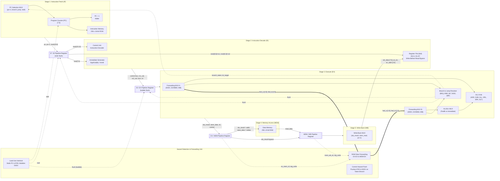

# Comprehensive Architecture & Hardware Pipeline Manual
## Complete Datapath, Control Unit, and Hazard Management Specification

This document provides the full hardware architectural schematic, signal dictionary, and wire-by-wire breakdown corresponding directly to the synthesizable SystemVerilog RTL in [rtl/cpu_core.sv](file:///c:/Users/Rishabh/Documents/antigravity/resilient-lovelace/rtl/cpu_core.sv).

> [!TIP]
> A high-resolution, vector graphic schematic is available in [docs/cpu_pipeline_schematic.svg](file:///c:/Users/Rishabh/Documents/antigravity/resilient-lovelace/docs/cpu_pipeline_schematic.svg). You can open it in any web browser or image viewer at 100% vector fidelity.

---

## 1. Extending This Core to 32-Bit Standard RISC-V (RV32I): What Changes?

If your goal is to transition from this 8-bit RISC processor to a complete **32-Bit RISC-V (RV32I)** processor, here is the exact architectural delta:

| Architectural Component | Our Custom 8-Bit RISC Core | Standard 32-Bit RISC-V (RV32I) | What Needs to Be Modified? |
| :--- | :--- | :--- | :--- |
| **Data Width** | 8 bits (`[7:0]`) | 32 bits (`[31:0]`) | Change `DATA_WIDTH = 32`. Registers, ALU buses, and memory data become 32 bits. |
| **Address Width** | 8 bits (256 bytes) | 32 bits (4 GB byte-addressable) | Change `ADDR_WIDTH = 32`. Program counter and memory address buses become 32 bits. |
| **Instruction Width** | 16 bits | 32 bits | Change `INSTR_WIDTH = 32`. All instructions are 32-bit fixed words. |
| **Register File** | 8 registers ($R_0 - R_7$) | 32 registers ($x_0 - x_{31}$) | Address width expands from 3 bits (`[2:0]`) to 5 bits (`[4:0]`). $x_0$ remains hardwired to zero. |
| **Instruction Formats** | Custom 4-bit Opcode + Funct | 6 Standard Formats: R, I, S, B, U, J | Opcode becomes 7 bits (`instr[6:0]`), funct3 is 3 bits (`instr[14:12]`), funct7 is 7 bits (`instr[31:25]`). |
| **Immediate Generator** | SignExt 6-bit / 8-bit | Reconstructed Immediate Unit | In RV32I, immediates are scrambled across fixed instruction bits to keep the sign bit always at `instr[31]`. |
| **Memory Access Granularity** | Byte-only (`LD`, `ST`) | Byte, Halfword, Word (`LB, LH, LW, SB, SH, SW`) | Add 4 byte-enable strobe signals (`wstrb[3:0]`) and a sign/zero-extension unit for halfwords and bytes. |
| **5-Stage Pipeline Core** | **IF, ID, EX, MEM, WB** | **IF, ID, EX, MEM, WB** | **UNCHANGED!** The pipeline registers, clocking, and stage structure are 100% identical. |
| **RAW Forwarding Unit** | EX $\rightarrow$ EX, MEM $\rightarrow$ EX | EX $\rightarrow$ EX, MEM $\rightarrow$ EX | **UNCHANGED!** Forwarding condition logic and comparator structures are identical. |
| **Load-Use Hazard Detection** | 1-cycle stall bubble | 1-cycle stall bubble | **UNCHANGED!** Identical interlock condition: `ID/EX.mem_read && (ID/EX.rd == rs1 || ID/EX.rd == rs2)`. |
| **Control Hazard Flushing** | 2-cycle branch flush | 2-cycle branch flush | **UNCHANGED!** Same synchronous clear on IF/ID and ID/EX registers. |

> [!NOTE]
> **Key Takeaway:** You have already mastered 90% of the hardest architectural challenges of a 32-bit RISC-V processor! The pipelining, forwarding muxes, hazard detection, and stall/flush control logic you implemented here are the exact same mechanisms used in real-world RV32I cores.

---

## 2. Global Pipeline Architecture Flowchart

---

## 3. Wire-by-Wire Signal Dictionary

Below is the complete inventory of all ports, buses, and control wires in the processor, matching [rtl/cpu_core.sv](file:///c:/Users/Rishabh/Documents/antigravity/resilient-lovelace/rtl/cpu_core.sv):

### 3.1 Instruction Fetch (IF) Stage

| Signal Name | Source | Destination | Width | Purpose |
| :--- | :--- | :--- | :---: | :--- |
| `pc` | PC Register | IMem, Adder, IF/ID | 8 bits | Current instruction word address ($0 - 255$). |
| `pc_next` | PC MUX | PC Register | 8 bits | Selected next PC value (sequential, branch, jump, or stall). |
| `pc_plus_1` | Adder (`pc + 1`) | PC MUX, IF/ID | 8 bits | Sequential next program address. |
| `imem_addr` | CPU Core Output | `instruction_mem` | 8 bits | Instruction memory address driven by `pc`. |
| `imem_data` | `instruction_mem` | IF/ID Register | 16 bits | 16-bit instruction word fetched asynchronously in single cycle. |
| `stall` | `hazard_unit` | PC Register | 1 bit | Active high when load-use hazard occurs; freezes `pc`. |

### 3.2 Instruction Decode (ID) Stage

| Signal Name | Source | Destination | Width | Purpose |
| :--- | :--- | :--- | :---: | :--- |
| `if_id_out.instr` | IF/ID Register | `control_unit`, RegFile | 16 bits | Instruction word under decode. |
| `cu_rs1`, `cu_rs2` | `control_unit` | `reg_file.rs1/2_addr` | 3 bits each | Source register indices extracted from instruction fields. |
| `cu_rd` | `control_unit` | ID/EX Register | 3 bits | Destination register index. |
| `rf_rs1_data` | `reg_file` | ID/EX Register | 8 bits | Read operand 1 data (asynchronous read with internal WB bypass). |
| `rf_rs2_data` | `reg_file` | ID/EX Register | 8 bits | Read operand 2 data. |
| `cu_imm` | `control_unit` | ID/EX Register | 8 bits | Extracted immediate (sign-extended 6-bit or raw 8-bit). |
| `cu_alu_op` | `control_unit` | ID/EX Register | 4 bits | ALU operation code (`ALU_ADD`, `ALU_SUB`, `ALU_SRA`, etc.). |
| `cu_alu_src` | `control_unit` | ID/EX Register | 1 bit | `0` = Operand B is register, `1` = Operand B is immediate. |
| `cu_reg_write`| `control_unit` | ID/EX Register | 1 bit | Destination register write enable. |
| `cu_mem_read` | `control_unit` | ID/EX Register | 1 bit | Data memory read enable (active for `LD`). |
| `cu_mem_write`| `control_unit` | ID/EX Register | 1 bit | Data memory write enable (active for `ST`). |
| `cu_mem_to_reg`| `control_unit` | ID/EX Register | 1 bit | Write-back select: `0` = ALU result, `1` = Memory data. |
| `cu_branch_type`| `control_unit` | ID/EX Register | 3 bits | Branch condition: `BR_NONE`, `BR_BEQ`, `BR_BNE`, `BR_BLT`, `BR_BGE`. |

### 3.3 Execute (EX) Stage

| Signal Name | Source | Destination | Width | Purpose |
| :--- | :--- | :--- | :---: | :--- |
| `fwd_a_data` | FWD MUX A | `alu.a`, Branch Comp | 8 bits | Selected operand A (from ID/EX, forwarded EX/MEM, or forwarded WB). |
| `fwd_b_data` | FWD MUX B | ALUSrc MUX, Branch Comp | 8 bits | Selected operand B. |
| `alu_in_b` | ALUSrc MUX | `alu.b` | 8 bits | Final ALU operand B: either `fwd_b_data` or `id_ex_out.imm`. |
| `alu_result` | `alu` | EX/MEM Register | 8 bits | Output of arithmetic, logic, or shift calculation. |
| `branch_taken`| Branch Resolver | PC Mux, `hazard_unit` | 1 bit | High if branch condition evaluated TRUE. |
| `branch_target_ex` | Adder | PC MUX | 8 bits | Computed target: `id_ex_out.pc_plus_1 + id_ex_out.imm`. |
| `jump_target_ex` | Target MUX | PC MUX | 8 bits | `id_ex_out.imm` for `JMP/JAL`, or `alu_in_a` for `JR`. |

### 3.4 Memory Access (MEM) Stage

| Signal Name | Source | Destination | Width | Purpose |
| :--- | :--- | :--- | :---: | :--- |
| `dmem_addr` | EX/MEM Register | `data_mem.addr` | 8 bits | Data memory address driven by `alu_result`. |
| `dmem_wdata`| EX/MEM Register | `data_mem.write_data` | 8 bits | Store data from forwarded operand B (`mem_write_data`). |
| `dmem_we` | EX/MEM Register | `data_mem.mem_write` | 1 bit | Synchronous RAM write strobe. |
| `dmem_re` | EX/MEM Register | `data_mem.mem_read` | 1 bit | RAM read strobe. |
| `dmem_rdata`| `data_mem` | MEM/WB Register | 8 bits | Asynchronously read memory byte. |

### 3.5 Write-Back (WB) Stage

| Signal Name | Source | Destination | Width | Purpose |
| :--- | :--- | :--- | :---: | :--- |
| `wb_data` | WB MUX | RegFile, Forwarding Unit | 8 bits | Final value to write into destination register $R_d$. |
| `rf_wr_en` | MEM/WB Register | `reg_file.wr_en` | 1 bit | Synchronous write enable to register file on rising clock edge. |
| `rf_wr_addr`| MEM/WB Register | `reg_file.wr_addr` | 3 bits | Register index ($R_1 - R_7$) being updated. |

---

## 4. Hazard Detection & Forwarding Circuit Truth Tables

### 4.1 RAW Forwarding Unit Truth Table
Evaluated combinatorially in the `EX` stage:

| Forward Condition | Selected Forward Value (`fwd_a_data` / `fwd_b_data`) | `fwd_a / fwd_b` Code |
| :--- | :--- | :---: |
| `EX/MEM.reg_write && (EX/MEM.rd != 0) && (EX/MEM.rd == ID/EX.rs1)` | `ex_mem_out.alu_result` (or `pc+1` if JAL) | `2'b01 (FWD_MEM)` |
| `MEM/WB.reg_write && (MEM/WB.rd != 0) && (MEM/WB.rd == ID/EX.rs1)` *(and not forwarded from EX/MEM)* | `wb_data` | `2'b10 (FWD_WB)` |
| None of the above | `id_ex_out.rs1_val` (normal register file read) | `2'b00 (FWD_NONE)` |

### 4.2 Hazard Stall and Flush Action Matrix

| Pipeline Event | `stall` (Freeze PC & IF/ID) | `flush_if_id` | `flush_id_ex` (Bubble into EX) | Consequence |
| :--- | :---: | :---: | :---: | :--- |
| **Normal Cycle** | `0` | `0` | `0` | Continuous 1 instruction/cycle flow. |
| **Load-Use Hazard** | `1` | `0` | `1` | PC holds address; IF/ID holds instruction; ID/EX de-asserts control signals into a NOP bubble (1 cycle penalty). |
| **Branch Taken / Jump** | `0` | `1` | `1` | IF/ID and ID/EX cleared to zero; PC loads branch target (2 cycle flush penalty). |
| **Branch Not Taken** | `0` | `0` | `0` | Prediction continues along fall-through path (0 cycle penalty). |
