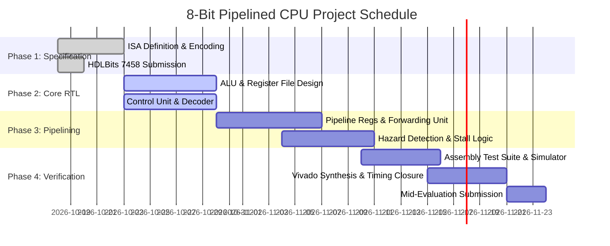

# Project Proposal & Architecture Report: 8-Bit Pipelined RISC Microprocessor
## Science & Technology Council, IIT Indore — Students Gymkhana

---

## 1. Executive Summary

This report outlines the design, architecture, hazard mitigation strategies, work distribution, and proposed timeline for the **Design and Implementation of an 8-bit Pipelined Microprocessor in SystemVerilog**. 

The proposed architecture implements a classic **5-stage RISC pipeline (IF, ID, EX, MEM, WB)** with Harvard memory organization, full **RAW data forwarding**, **hardware load-use hazard interlocks**, and **control hazard branch flushing**.

---

## 2. Architectural Design & Instruction Constraints

### 2.1 Harvard Architecture & Datapath
To prevent structural hazards between instruction fetches and data memory accesses, the processor utilizes independent **Instruction Memory (256 x 16-bit)** and **Data Memory (256 x 8-bit)**. 

### 2.2 Overcoming Specific Instruction Constraints

| Constraint / Requirement from Problem Statement | Architectural Solution & Overcoming Strategy |
| :--- | :--- |
| **Loading Immediate Values** | Implemented `LDI Rd, Imm8` with an 8-bit immediate payload in `instr[7:0]`. The ALU executes `ALU_PASS_B` to pass the immediate directly into `Rd` without ALU latency penalty. |
| **Register-to-Register Arithmetic** | Dedicated 8-bit ALU supporting `ADD` and `SUB` with status flags (`Zero`, `Negative`, `Carry`, `Overflow`). |
| **Signed vs. Unsigned Bitwise Shifts** | The ALU features a dual-mode barrel shifter: <br> • **`SRL` (Shift Right Logical):** Fills top bits with `0` for unsigned quantities. <br> • **`SRA` (Shift Right Arithmetic):** Replicates the sign bit ($b_7$) to preserve 2's complement negative arithmetic values. |
| **Signed vs. Unsigned Comparisons** | Distinct instructions: <br> • **`SLT`:** Uses signed comparison `$signed(Rs1) < $signed(Rs2)`. <br> • **`SLTU`:** Uses raw magnitude comparison `Rs1 < Rs2`. |
| **Memory Load & Store Operations** | Base-plus-offset addressing `LD Rd, [Rs1 + offset]` and `ST Rs2, [Rs1 + offset]` with 6-bit sign-extended immediate offset. |
| **Control Flow (Branches & Jumps)** | Supports both conditional PC-relative branches (`BEQ`, `BNE`, `BLT`, `BGE`) and absolute jumps (`JMP`, `JAL`, `JR`). `JAL` writes `PC+1` into `Rd` to support function calls and returns. |

---

## 3. Pipelining Strategy & Hazard Management

```
Cycle:      1     2     3     4     5     6     7
Instr 1: [ IF ][ ID ][ EX ][ MEM ][ WB ]
Instr 2:       [ IF ][ ID ][ EX ][ MEM ][ WB ]
Instr 3:             [ IF ][ ID ][ EX ][ MEM ][ WB ]
Instr 4:                   [ IF ][ ID ][ EX ][ MEM ][ WB ]
```

### 3.1 Data Hazard Resolution (RAW)
When an instruction depends on a value produced by a preceding instruction:
1. **EX-to-EX Forwarding:** If instruction $N$ writes back to a register needed by instruction $N+1$ in EX stage, the output of `EX/MEM` is multiplexed directly into the ALU operand input.
2. **MEM-to-EX Forwarding:** If instruction $N$ produces a result needed by instruction $N+2$, `MEM/WB` forwards the data to the ALU.
3. **Internal RegFile Forwarding:** If instruction $N$ writes in WB at the exact cycle instruction $N+3$ reads in ID, an internal bypass inside `reg_file.sv` forwards the write data immediately.
* **Result:** **Zero stall cycles** for register-register data dependencies!

### 3.2 Load-Use Hazard Resolution
Because memory read data is not valid until the end of the `MEM` stage, an instruction immediately following a `LD` that uses the loaded register cannot receive the data via forwarding in time.
* **Detection:** `if (ID/EX.mem_read && (ID/EX.rd == IF/ID.rs1 || ID/EX.rd == IF/ID.rs2))`
* **Action:** The Hazard Detection Unit:
  1. Freezes the Program Counter (`PC` holds its value).
  2. Freezes the `IF/ID` pipeline register.
  3. Injects a bubble into `ID/EX` (clears control signals).
* **Result:** Exactly **1 cycle latency penalty**, maintaining complete data integrity.

### 3.3 Control Hazard Resolution (Branches & Jumps)
Branches and jumps are evaluated in the `EX` stage:
* **Branch Not Taken:** Sequential execution continues with **0 penalty cycles**.
* **Branch Taken / Jump:** Assert `flush_if_id` and `flush_id_ex` to synchronously clear the two instructions currently fetched on the wrong path into NOPs, redirecting PC to the target address (**2-cycle penalty**).

---

## 4. Team Work Distribution (4 Members)

| Team Member | Subsystem Ownership & Deliverables |
| :--- | :--- |
| **Member 1 (Lead)** | **Datapath & Execution:** ALU module (`alu.sv`), signed/unsigned barrel shifter, arithmetic overflow detection, and Register File (`reg_file.sv`). |
| **Member 2** | **Control Unit & ISA Tooling:** Instruction Decoder (`control_unit.sv`), immediate generation, custom assembler (`scripts/assemble.py`), and machine code generation. |
| **Member 3** | **Pipeline & Hazard Management:** Pipeline stage registers (`pipeline_regs.sv`), Hazard Detection Unit, RAW Forwarding Unit (`hazard_unit.sv`), and branch flush logic. |
| **Member 4** | **Top-Level Integration & Verification:** Memory subsystems (`instruction_mem.sv`, `data_mem.sv`), top-level SoC wrapper (`cpu_top.sv`), testbench assertions (`tb_cpu.sv`), and Vivado project automation. |

---

## 5. Proposed Project Timeline



---

## 6. HDLBits 7458 Problem Verification

As required by the selection criteria, all team members have verified and solved the **7458 - HDLBits** problem. The full solution, Boolean equations, and gate-level schematic analysis are documented in [docs/HDLBITS_7458_SOLUTION.md](HDLBITS_7458_SOLUTION.md).
